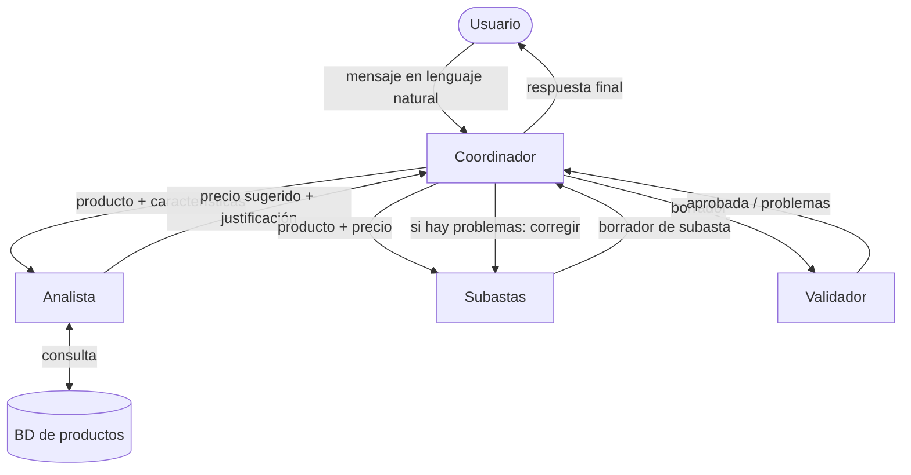

# Guía del TP Integrador: Sistema Multiagente de Subastas

> Documento de trabajo del grupo. Acá está el contexto del TP, los conceptos que tenemos que aprender y los pasos a seguir.
> El `README.md` final (el que pide el profe) lo escribimos al terminar (ver Fase 7).

---

## 1. Contexto

**Materia:** Redes Neuronales. **Entrega:** trabajo integrador grupal (2 o 3 personas). **Defensa:** semana 14, de 10 a 15 minutos.

**Consigna (resumen):** diseñar, implementar y probar un sistema de **agentes con IA** donde:

- haya **al menos 3 agentes** (se recomiendan 4 o más),
- cada agente tenga **rol, objetivo, entrada y salida** bien definidos,
- haya **coordinación explícita** entre ellos (secuencial o colaborativa),
- se use **IA de forma explícita** (LLM, clasificación, generación, etc.),
- haya **pruebas** que demuestren que funciona.

**Qué hay que entregar:**

- [ ] Código (scripts o notebooks) que implemente el sistema
- [ ] Diagrama del sistema (roles y flujos)
- [ ] Descripción escrita del diseño y del funcionamiento
- [ ] Evidencia de las pruebas
- [ ] `README.md` con una breve explicación del proyecto, cómo ejecutarlo y la estructura (lo pidió el profe porque entregamos por GitHub)

**Cómo nos van a evaluar:** claridad del diseño, roles e interacciones bien definidos, uso pertinente de IA, que funcione, y que lo sepamos defender.

### Lo que acordamos con el profe

- La idea de subastas **está aprobada**.
- Nos pidió **primero un diagrama o esquema** con: el rol de cada agente, cómo se comunican, qué recibe y devuelve cada uno, y **en qué momento interviene el coordinador**.
- Podemos **ajustar, agregar o unificar agentes** a medida que avancemos.
- Podemos entregar por **GitHub** con un README.

---

## 2. La idea

Un usuario le escribe al sistema en lenguaje natural, por ejemplo:

> "Quiero subastar mi PS5 pero no sé a qué precio, ¿qué me recomendás?"

El sistema entiende qué quiere, busca productos parecidos para estimar un precio, arma la publicación de la subasta y verifica que esté completa antes de devolverla.

### Agentes (primera versión)

| # | Agente | Rol | Entrada | Salida |
|---|--------|-----|---------|--------|
| 1 | **Coordinador** | Entiende la intención del usuario y decide qué agentes llamar y en qué orden | Mensaje del usuario | Plan: lista de pasos (ej. `["analyst", "auction", "validator"]`) + datos extraídos (producto, estado, etc.) |
| 2 | **Analista** | Estima un precio razonable comparando con productos similares en la BD | Producto + características | Precio sugerido, rango, productos comparables usados y justificación |
| 3 | **Subastas** | Arma la publicación de la subasta | Producto + precio sugerido | Título, descripción, precio base, categoría, duración |
| 4 | **Validador** | Revisa que la subasta cumpla los requisitos | Subasta armada | `approved: true/false` + lista de problemas |

> **Ojo con el orden:** en el mensaje al profe pusimos Subastas como agente 2 y Analista como 3, pero en el flujo del ejemplo conviene que el **Analista vaya antes**, porque Subastas necesita el precio. Esto es justo el tipo de decisión que tenemos que poder explicar en la defensa.

### Flujo del ejemplo (borrador del diagrama)

GitHub dibuja este diagrama automáticamente (es [Mermaid](https://mermaid.js.org/)):



Fijate que **todo pasa por el Coordinador** (arquitectura "hub and spoke" o de orquestador). La alternativa sería un pipeline donde cada agente le pasa la salida directamente al siguiente. Pensar: ¿cuál conviene y por qué? (pista: ¿qué pasa si el usuario solo quiere saber el precio y no crear la subasta?)

---

## 3. Conceptos que tenemos que entender

Antes de programar, cada integrante debería poder explicar estos conceptos con sus palabras. Los vamos a usar en la defensa.

1. **LLM (Large Language Model):** un modelo que recibe texto y genera texto. No "sabe" nada de nuestra BD: solo sabe lo que le pasamos en el prompt.
2. **Agente:** un LLM con un **rol fijo** (definido en el *system prompt*), una **entrada** y una **salida** acotadas y, a veces, **herramientas** (funciones que puede usar, como consultar la BD). Un agente NO es un modelo distinto: pueden ser todos el mismo LLM con instrucciones diferentes.
3. **System prompt vs. user prompt:** el system prompt define *quién es* el agente y *cómo responde*; el user prompt es *lo que tiene que procesar ahora*.
4. **Salida estructurada (JSON):** para que un agente le pase información a otro, conviene que responda en JSON con un formato fijo y no en texto libre. Así el código puede leerlo sin ambigüedad. Es el "contrato" entre agentes.
5. **Orquestación / coordinación:** quién decide qué agente se ejecuta y cuándo. Puede ser **fija** (siempre el mismo orden, escrita en el código) o **dinámica** (el Coordinador-LLM decide). Nosotros tenemos un Coordinador, así que es dinámica.
6. **Herramientas (tools / function calling):** en vez de que el LLM "invente" precios, le damos una función `search_similar(product)` que consulta la BD de verdad. El LLM decide usarla e interpreta el resultado.
7. **Estado compartido:** un diccionario (o objeto) donde se va acumulando lo que produce cada agente (producto, precio, borrador, validación). Es la "memoria" de una ejecución.
8. **Lazo de corrección (feedback loop):** si el Validador rechaza, la subasta vuelve a Subastas con los errores. Hay que poner un **límite de reintentos** para no quedar en un bucle infinito.
9. **¿Por qué varios agentes y no un único prompt gigante?** Tenemos que poder justificarlo: separación de responsabilidades, prompts más cortos y precisos, se puede probar cada parte por separado, se puede cambiar una sin romper las demás, y el Validador da un control independiente.

### Cómo se traducen estos conceptos a LangGraph

[LangGraph](https://langchain-ai.github.io/langgraph/) modela el sistema como un **grafo**. Cada concepto de arriba tiene su equivalente:

| Concepto | En LangGraph | En nuestro sistema |
|----------|--------------|--------------------|
| Estado compartido | `State`: un `TypedDict` que define qué datos viajan por el grafo | `message`, `intent`, `product`, `user_price`, `analysis`, `draft`, `validation`, `retries`… |
| Agente | **Nodo**: una función que recibe el estado y devuelve **solo lo que actualiza** | `coordinator`, `analyst`, `auction`, `validator` |
| Orden fijo | **Arista** (`add_edge`): "después de A va B" | `auction → validator` |
| Decisión / coordinación | **Arista condicional** (`add_conditional_edges`): una función mira el estado y elige el próximo nodo | Después del Coordinador: ¿analista, subastas o fin? Después del Validador: ¿fin o volver a subastas? |
| Lazo de corrección | Un **ciclo** en el grafo | `validator → auction` si fue rechazada |
| Herramienta | Una función decorada con `@tool` (LangChain) | `search_similar` |
| Salida estructurada | `llm.with_structured_output(MyPydanticModel)` (LangChain) | Cada agente devuelve un objeto con campos fijos y no texto libre |

Y **LangChain** es la capa que usamos para hablar con el LLM (`ChatGoogleGenerativeAI`), armar prompts y pedir salidas estructuradas.

Algo interesante para la defensa: en LangGraph, el "Coordinador" puede ser un **nodo LLM** que decide la intención, más una **función de ruteo** (código normal) que lee esa decisión y elige la arista. Así la IA decide *qué quiere el usuario*, pero el código controla *a dónde se puede ir* (no puede inventar un agente que no existe).

---

## 4. Decisiones técnicas

| Decisión | Elegido / opciones | Comentario |
|----------|--------------------|------------|
| Framework | **LangGraph + LangChain** ✅ | LangGraph para el flujo entre agentes (grafo), LangChain para hablar con el LLM. |
| LLM | **Google GenAI (Gemini)** ✅ | Tiene capa gratuita. Se usa desde LangChain con el paquete `langchain-google-genai`. La API key se saca en [Google AI Studio](https://aistudio.google.com/). Cada integrante puede tener su propia key. |
| Base de datos | **SQLite** ✅ | Viene con Python (`sqlite3`), no necesita servidor y permite buscar similares con consultas SQL. |
| Interfaz | Consola, notebook o Streamlit (a decidir) | Consola o notebook alcanza. Streamlit queda lindo para la demo, pero es opcional. |

Dependencias iniciales (`requirements.txt`): `langgraph`, `langchain`, `langchain-google-genai`, `python-dotenv`. SQLite no se instala: viene con Python.

**Consejo para aprender LangGraph:** antes de meter IA, armen un grafo de juguete con nodos que solo hagan `print` y modifiquen el estado. Cuando entiendan cómo fluye el estado y cómo funcionan las aristas condicionales, recién ahí cambian los nodos por llamadas al LLM. LangGraph también puede **dibujar el grafo** (`graph.get_graph().draw_mermaid()`), que sirve como diagrama para la entrega.

**Ojo con las versiones:** LangChain y LangGraph cambian seguido. Si un tutorial no anda, revisen que sea de una versión reciente y fijen las versiones en `requirements.txt` cuando algo funcione (`pip freeze`).

**Regla de oro:** las API keys van en un archivo `.env` que **nunca se sube a GitHub** (agregarlo al `.gitignore`). En el repo se sube un `.env.example` sin la clave real.

---

## 5. Estructura propuesta del repo

```
TP-RN-UP/
├── README.md            # Explicación final del proyecto (Fase 7)
├── GUIA.md              # Este archivo
├── requirements.txt     # Dependencias de Python
├── .env.example         # Ejemplo de variables (sin claves reales)
├── .gitignore
├── docs/
│   └── diagrama.md      # Diagrama + descripción de cada agente
├── data/
│   ├── create_db.py     # Crea la tabla y carga los productos de ejemplo
│   └── products.db      # BD SQLite (se genera con create_db.py, no se sube a git)
├── src/
│   ├── db.py            # Conexión a la BD (un solo lugar)
│   ├── llm.py           # Crea el modelo Gemini (un solo lugar)
│   ├── state.py         # Definición del State (TypedDict)
│   ├── tools.py         # search_similar y otras tools
│   ├── agents/          # Un nodo por archivo
│   │   ├── coordinator.py
│   │   ├── analyst.py
│   │   ├── auction.py
│   │   └── validator.py
│   ├── graph.py         # Arma el StateGraph: nodos + aristas
│   └── main.py          # Punto de entrada
└── tests/               # Pruebas y casos de prueba
```

Es una propuesta: si les resulta más cómodo, empiecen con un solo notebook y después lo separan en archivos.

---

## 6. Pasos a seguir

Cada fase tiene un **objetivo**, **qué aprendemos**, **tareas** y una **pregunta para pensar** (buen material para la defensa).

### Fase 0: Organización (día 1)

**Objetivo:** que todos puedan trabajar en el repo.

- [ ] Invitar a los integrantes como colaboradores en GitHub
- [ ] Cada uno clona el repo, crea un entorno virtual (`python -m venv .venv`) e instala las dependencias (`pip install -r requirements.txt`)
- [ ] Cada uno saca su API key de Gemini y la pone en su `.env` local
- [ ] Crear `.gitignore` (como mínimo: `.venv/`, `.env`, `__pycache__/`, `.ipynb_checkpoints/`)
- [ ] Acordar el flujo de trabajo con git: una rama por tarea (`git checkout -b analyst`) y *pull request* para juntar los cambios en `main`
- [ ] Repartir responsabilidades (ver sección 7)

### Fase 1: Diseño y diagrama (lo que pidió el profe)

**Objetivo:** tener la arquitectura cerrada **antes** de programar.
**Aprendemos:** a definir contratos entre agentes.

- [ ] Para cada agente, escribir en `docs/diagrama.md`: rol, objetivo, entrada (con un JSON de ejemplo), salida (con un JSON de ejemplo) y cuándo se lo llama
- [ ] Definir qué **intenciones** puede detectar el Coordinador. Ejemplos: `create_auction`, `price_query`, `create_auction_with_price`, `off_topic`
- [ ] Para cada intención, qué agentes participan y en qué orden
- [ ] Definir las **reglas del Validador** (ej.: título de 10 a 80 caracteres, descripción no vacía, precio mayor a 0, categoría válida…)
- [ ] Pasar el diagrama de Mermaid de la sección 2 a su versión final
- [ ] (Opcional) Mandárselo al profe para que lo revise

**Pregunta para pensar:** ¿qué hace el sistema si el usuario escribe "hola, ¿cómo estás?" o "subastá mi auto" sin dar ningún dato?

### Fase 2: Base de datos de productos

**Objetivo:** que el Analista tenga datos reales para comparar.
**Aprendemos:** por qué un LLM necesita datos externos (no conoce precios actuales ni nuestra BD), SQL básico y consultas parametrizadas.

- [ ] Diseñar la tabla `products` (columnas sugeridas: `id, name, category, description, condition, final_price, date`) y elegir el tipo de cada columna
- [ ] Escribir `data/create_db.py`, que crea la tabla (`CREATE TABLE`) y carga unos 30 a 50 productos de ejemplo (`INSERT`). Así cualquiera del grupo regenera la BD desde cero con un comando
- [ ] Incluir varios productos de la misma categoría (varias consolas, varios celulares…) para que haya con qué comparar
- [ ] Escribir una función `search_similar(category, keywords)` que haga un `SELECT` y devuelva los productos parecidos. **Esto es código normal, sin IA.**
- [ ] Usar **consultas parametrizadas** (`cursor.execute("... WHERE category = ?", (category,))`) y nunca armar el SQL concatenando strings: las palabras clave vienen de un LLM y podrían contener cualquier cosa (inyección SQL)
- [ ] Calcular mínimo, máximo y mediana. Ojo: SQLite tiene `MIN` y `MAX`, pero **no tiene `MEDIAN`**. Se puede calcular en Python con el módulo `statistics`

**Pregunta para pensar:** ¿el precio lo calcula el LLM o lo calcula Python (por ejemplo, la mediana de los similares) y el LLM solo lo justifica? ¿Qué es más confiable y por qué?

### Fase 3: Primer contacto con Gemini y LangGraph

**Objetivo:** hacer andar el LLM desde Python y entender un grafo básico.
**Aprendemos:** API keys, system prompt vs. user prompt, salida estructurada, State/nodos/aristas.

Parte A, el LLM:

- [ ] Conseguir la API key en Google AI Studio y guardarla en `.env` (`GOOGLE_API_KEY=...`)
- [ ] En `src/llm.py`, crear el modelo con `ChatGoogleGenerativeAI` en **un solo lugar** (todos los agentes lo importan de ahí)
- [ ] Hacer una llamada simple con un mensaje de sistema y uno de usuario e imprimir la respuesta
- [ ] Definir un modelo **Pydantic** chico (ej. `Intent` con los campos `type` y `product`) y usar `llm.with_structured_output(Intent)`. Ver que devuelve un objeto y no texto.

Parte B, LangGraph de juguete (sin IA):

- [ ] Definir un `State` con 2 o 3 campos
- [ ] Crear 3 nodos que solo hagan `print` y actualicen un campo
- [ ] Conectarlos con `add_edge`, agregar **una** arista condicional y ejecutar con `graph.invoke(...)`
- [ ] Imprimir el diagrama con `draw_mermaid()`

**Pregunta para pensar:** ¿por qué es mejor `with_structured_output` que pedirle "respondé en JSON" y hacer `json.loads` a mano? ¿Y por qué conviene crear el modelo en un solo archivo?

### Fase 4: Cada agente por separado

**Objetivo:** que cada agente (nodo) funcione solo, con un estado de prueba escrito a mano.
**Aprendemos:** que un agente = prompt + entrada + salida + (a veces) herramienta.

Cada nodo es una función `def analyst(state: State) -> dict` que lee lo que necesita del estado y devuelve **solo los campos que cambia**. Como es una función normal, se puede probar sin armar el grafo: `analyst({"product": "PS5", ...})`.

Orden sugerido, de más simple a más complejo:

- [ ] **Validador**: puede ser una mezcla de reglas en Python (precio > 0, campos presentes) + LLM (¿la descripción es coherente con el título?)
- [ ] **Subastas**: recibe producto + precio y genera título y descripción atractivos
- [ ] **Analista**: usa `search_similar` y le pide al LLM que interprete y justifique el precio. Dos formas: (1) el nodo llama a la función y le pasa los resultados al LLM, o (2) se la damos como `@tool` con `llm.bind_tools(...)` y el LLM decide cuándo usarla. Empiecen por la (1); la (2) es un buen extra.
- [ ] **Coordinador**: recibe el texto del usuario y devuelve (con salida estructurada) la intención y los datos extraídos

Probar cada uno de forma aislada antes de conectarlos. Por ejemplo, darle al Validador una subasta mal hecha a propósito y ver que la rechace.

**Pregunta para pensar:** ¿qué partes del Validador conviene hacer con reglas fijas y cuáles con IA? ¿Por qué no hacer todo con IA?

### Fase 5: Coordinación (conectar todo)

**Objetivo:** el sistema completo funcionando de punta a punta.
**Aprendemos:** orquestación, estado compartido, lazo de corrección.

- [ ] En `graph.py`, crear el `StateGraph(State)` y agregar los 4 nodos
- [ ] Arista condicional después del **Coordinador**: una función `route(state)` que según la intención devuelve `"analyst"`, `"auction"` o `END`
- [ ] Aristas fijas donde el orden siempre es el mismo (ej. `auction → validator`)
- [ ] Arista condicional después del **Validador**: si está aprobada → `END`; si no y quedan reintentos → `"auction"`; si no quedan → `END` con error. Llevar la cuenta de `retries` en el estado (máximo 2, por ejemplo)
- [ ] Ver la ejecución paso a paso con `graph.stream(...)` en lugar de `invoke`: muestra qué nodo se ejecutó y qué devolvió. Sirve para depurar y como **evidencia de las pruebas**
- [ ] Exportar el diagrama generado por LangGraph y compararlo con el de la Fase 1

**Pregunta para pensar:** si el Coordinador es un LLM, ¿qué pasa si clasifica mal la intención? ¿Qué parte del ruteo controla la IA y qué parte controla nuestro código?

### Fase 6: Pruebas

**Objetivo:** demostrar que funciona (es un requisito de la consigna).
**Aprendemos:** a evaluar sistemas con IA, que no siempre responden lo mismo.

- [ ] Armar una lista de **casos de prueba**: entrada → resultado esperado. Ejemplos:
  - Caso normal: "Quiero subastar mi PS5, ¿a cuánto?" → plan con analista + subastas + validador, precio dentro del rango de los similares
  - Solo precio: "¿Cuánto vale una Nintendo Switch usada?" → solo el analista
  - Producto sin similares en la BD → el Analista avisa que no tiene datos suficientes
  - Pedido incompleto: "Quiero subastar algo" → el sistema pide más información
  - Fuera de tema: "¿Qué hora es?" → respuesta educada, sin llamar a ningún agente
  - Subasta inválida → el Validador la rechaza y se corrige
- [ ] Correr cada caso, guardar la salida y el log (en `tests/` o en un notebook de evidencia)
- [ ] Anotar qué casos fallaron, por qué, y qué cambiamos (¡esto suma mucho en la defensa!)

**Pregunta para pensar:** si corremos el mismo caso 5 veces, ¿da siempre lo mismo? ¿Qué influye (temperatura del modelo)?

### Fase 7: Documentación y defensa

- [ ] Escribir el `README.md` final: qué es el proyecto, cómo instalarlo y ejecutarlo, estructura de carpetas, diagrama
- [ ] Preparar la presentación (10 a 15 minutos): problema → arquitectura → agentes → demo → pruebas → conclusiones y mejoras
- [ ] Ensayar la demo (y tener capturas o un video de respaldo por si falla internet o la API)
- [ ] Repasar las preguntas de la sección 8

---

## 7. Reparto sugerido (ajustar según el grupo)

| Integrante | Responsable de |
|------------|----------------|
| A | Coordinador + `main.py` (orquestación) + README |
| B | Analista + base de datos + `search_similar` |
| C | Subastas + Validador + casos de prueba |

**Todos** tienen que entender el sistema completo: en la defensa pueden preguntarle cualquier cosa a cualquiera.

---

## 8. Preguntas probables en la defensa

- ¿Por qué usaron varios agentes y no un solo prompt?
- ¿Qué hace exactamente el Coordinador y cómo decide?
- ¿Dónde está la IA y dónde hay código "normal"? ¿Por qué lo dividieron así?
- ¿Qué pasa si el LLM se equivoca o inventa un precio?
- ¿Cómo probaron que funciona? ¿Qué falló?
- ¿Unificarían o agregarían algún agente? (ej.: ¿hace falta un agente aparte para el Validador?)
- ¿Qué mejorarían con más tiempo? (precios reales con scraping, más categorías, interfaz web, memoria entre conversaciones…)

---

## 9. Cómo usar a Claude en este TP

La idea es **aprender**, no que la IA haga el TP. Formas útiles de pedir ayuda:

- "Explicame el concepto X con un ejemplo chico"
- "Escribí mi código para el agente X, ¿qué está mal o qué mejorarías?" (revisión, no reescritura)
- "Dame una pista para resolver X, sin darme el código"
- "Haceme preguntas como si fueras el profe en la defensa"

---

## Registro de decisiones

Anotar acá cada decisión importante y por qué (sirve para el informe y la defensa).

| Fecha | Decisión | Motivo |
|-------|----------|--------|
| 2026-10-16 | Tema: sistema multiagente de subastas | Aprobado por el profe |
| 2026-10-16 | Entrega por GitHub con README | Aprobado por el profe |
| 2026-10-16 | LangGraph + LangChain como framework | Modela el flujo como grafo: el ruteo del Coordinador y el lazo de corrección quedan explícitos |
| 2026-10-16 | Gemini (Google GenAI) como LLM | Capa gratuita y buena integración con LangChain |
| 2026-10-16 | SQLite como base de datos de productos | Viene con Python, no necesita servidor y permite consultas SQL |
| 2026-10-16 | Código en inglés; documentación en español | Las librerías están en inglés y así no se mezclan idiomas en el código. Los datos de productos quedan en español (mercado argentino) |
| | | |
