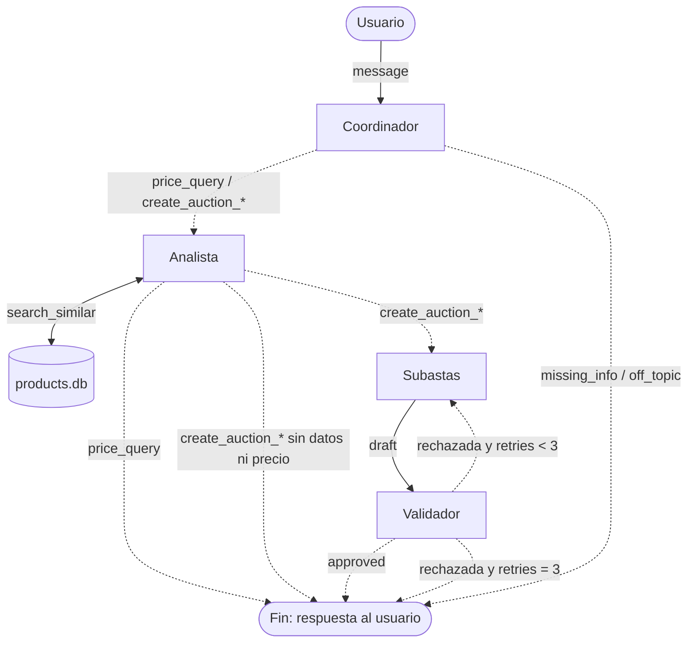
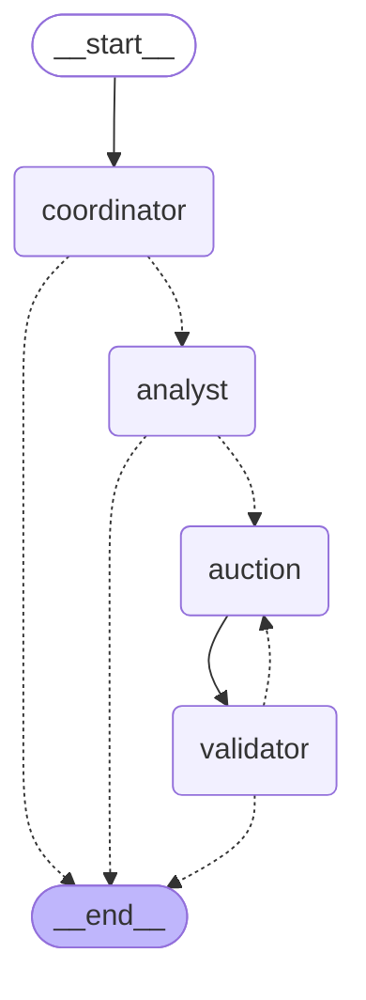

# Diseño del sistema multiagente de subastas

## 1. Intenciones que entiende el sistema

El Coordinador clasifica cada mensaje del usuario en una de estas intenciones. Según la intención, se ejecutan distintos agentes.

| Intención                  | Ejemplo de mensaje                            | Agentes que participan (en orden)                     |
| -------------------------- | --------------------------------------------- | ----------------------------------------------------- |
| `create_auction_no_price` | "Quiero subastar mi PS5, ¿a cuánto la pongo?" | Coordinador → Analista → Subastas → Validador         |
| `price_query`         | "¿Cuánto vale una Switch usada?"              | Coordinador → Analista                                |
| `create_auction_with_price` | "Quiero subastar mi PS5 a $500.000"           | Coordinador → Analista → Subastas → Validador         |
| `missing_info`             | "Quiero subastar algo"                        | Coordinador (le pide al usuario los datos que faltan) |
| `off_topic`            | "¿Qué hora es?"                               | Coordinador (responde que solo ayuda con subastas)    |

**¿Por qué el Analista participa aunque el usuario ya dé el precio?** Porque igual sirve compararlo con el mercado: si el usuario pide $500.000 y los similares se vendieron a $300.000, el sistema lo avisa. El precio que se publica sigue siendo el del usuario.

---

## 2. Estado compartido

Datos que viajan por el grafo. Cada agente lee algunos y escribe otros.

| Campo            | Tipo          | Quién lo escribe                                     | Quién lo lee                                                    |
| ---------------- | ------------- | ---------------------------------------------------- | --------------------------------------------------------------- |
| `message`        | str           | Usuario (entrada)                                    | Coordinador                                                     |
| `intent`      | str           | Coordinador                                          | Router del Coordinador                                          |
| `product`       | dict          | Coordinador                                          | Analista, Subastas                                              |
| `user_price` | float \| None | Coordinador                                          | Analista, Subastas                                              |
| `analysis`       | dict          | Analista                                             | Router del Analista, Subastas, respuesta final                  |
| `draft`       | dict          | Subastas                                             | Validador, respuesta final                                      |
| `validation`     | dict          | Validador                                            | Router del Validador, Subastas (en reintentos), respuesta final |
| `retries`     | int           | Subastas (suma 1 cada vez que genera)                | Router del Validador                                            |
| `response`      | str           | Coordinador o Analista (cuando el flujo termina ahí) | Usuario                                                         |

**Router** = función de código (sin IA) que mira el estado y decide a qué nodo ir después. En LangGraph es la función que se pasa a `add_conditional_edges`.

---

## 3. Agentes

### 3.1 Coordinador

- **Rol:** decide qué agentes tienen que intervenir según la consulta o el pedido del usuario.
- **Objetivo:** interpretar bien qué quiere el usuario y extraer los datos del producto para que los demás agentes trabajen.
- **¿Usa IA? ¿Para qué?:** sí. El LLM interpreta el mensaje en lenguaje natural, lo clasifica en una de las intenciones de la sección 1 y extrae los datos del producto (con salida estructurada). **No elige el próximo nodo**: eso lo hace el router (código), leyendo `intent`. Así el LLM nunca puede mandar el flujo a un agente que no existe. Del mismo modo, la `category` la elige de una **lista cerrada** (`consoles`, `phones`, `laptops`, `tvs`, `bicycles`, `other`); si el producto no encaja en ninguna, usa `other`.
- **Cuándo interviene:** siempre, apenas llega el mensaje del usuario. Es el punto de entrada del grafo.
- **Entrada:**
  ```json
  {
    "message": "Quiero subastar mi PS5 con 2 joysticks, la usé poco. ¿A cuánto la pongo?"
  }
  ```
- **Salida:**
  ```json
  {
    "intent": "create_auction_no_price",
    "product": {
      "name": "PlayStation 5",
      "category": "consoles",
      "condition": "used",
      "details": "2 joysticks, poco uso"
    },
    "user_price": null,
    "response": null
  }
  ```
  En `missing_info` y `off_topic` completa `response` (ej. "¿Qué producto querés subastar y en qué estado está?") y el flujo termina.

### 3.2 Analista

- **Rol:** responde dudas del usuario sobre el valor de mercado de productos similares.
- **Objetivo:** darle al usuario (y al agente de Subastas) la información necesaria para decidir un precio adecuado.
- **¿Usa IA? ¿Para qué?:** en parte. La búsqueda en la BD y las cuentas (mínimo, máximo, mediana) las hace **Python**, porque tienen que ser exactas. El LLM se usa para **interpretar** esos datos: descartar comparables que no se parecen (ej. una PS5 Digital vs. una Standard), redactar la justificación y, si el usuario dio un precio, opinar si está dentro del mercado.
- **Herramientas:** `search_similar(category, keywords) -> list[dict]`, que consulta la tabla `products` de la BD SQLite (`data/products.db`).
- **Cuándo interviene:** después del Coordinador, en `price_query`, `create_auction_no_price` y `create_auction_with_price`.
- **Entrada:**
  ```json
  {
    "product": {
      "name": "PlayStation 5",
      "category": "consoles",
      "condition": "used",
      "details": "2 joysticks, poco uso"
    },
    "user_price": null
  }
  ```
- **Salida:**
  ```json
  {
    "analysis": {
      "enough_data": true,
      "suggested_price": 450000,
      "min_price": 380000,
      "max_price": 520000,
      "comparables": [
        { "id": 1, "name": "PlayStation 5 Standard", "final_price": 420000 },
        { "id": 2, "name": "PlayStation 5 Standard", "final_price": 480000 }
      ],
      "reasoning": "Las PS5 Standard usadas se vendieron entre $380.000 y $520.000. Con 2 joysticks conviene ubicarla en la mitad del rango.",
      "user_price_feedback": null
    }
  }
  ```
  En `price_query` también completa `response` con un resumen para el usuario.
- **¿Qué pasa si no hay productos similares?:** (ej. un modelo que no está en la BD, o cualquier producto de la categoría `other`, como un juego de mesa) devuelve `enough_data: false` y `suggested_price: null`, y explica que no tiene datos de referencia. Después:
  - Si el usuario **dio un precio** → se sigue con Subastas usando ese precio.
  - Si **no dio precio** → el flujo termina y se le pide al usuario un precio de referencia (no inventamos precios).

### 3.3 Subastas

- **Rol:** redactor de la publicación de la subasta.
- **Objetivo:** armar una publicación completa y atractiva, sin inventar características que el usuario no mencionó.
- **¿Usa IA? ¿Para qué?:** sí, para generar el **título** y la **descripción** a partir de los datos del producto. El **precio base** lo define el código (no el LLM): el `user_price` si existe y, si no, el `suggested_price` del Analista. La duración tiene un valor por defecto (7 días).
- **Cuándo interviene:** después del Analista, en las intenciones de crear subasta. También cuando el Validador rechaza el borrador (reintento): en ese caso recibe los `issues` para corregirlos.
- **Entrada:**
  ```json
  {
    "product": {
      "name": "PlayStation 5",
      "category": "consoles",
      "condition": "used",
      "details": "2 joysticks, poco uso"
    },
    "user_price": null,
    "analysis": { "suggested_price": 450000, "...": "..." },
    "validation": null
  }
  ```
  En un reintento, `validation` trae los problemas: `{ "approved": false, "issues": ["El título supera los 80 caracteres"] }`.
- **Salida:**
  ```json
  {
    "draft": {
      "title": "PlayStation 5 Standard con 2 joysticks",
      "description": "Consola PS5 Standard usada, con poco uso. Incluye 2 joysticks...",
      "category": "consoles",
      "starting_price": 450000,
      "duration_days": 7
    },
    "retries": 1
  }
  ```

### 3.4 Validador

- **Rol:** control de calidad de la subasta antes de devolvérsela al usuario.
- **Objetivo:** asegurar que la subasta cumple todos los requisitos y, si no, explicar qué falta para que Subastas lo corrija.
- **¿Usa IA? ¿Para qué?:** en parte. Las reglas objetivas (campos presentes, precio > 0, largo del título) se chequean con código. El LLM solo evalúa lo subjetivo: si la descripción es coherente con el título y no tiene información inventada.
- **Cuándo interviene:** siempre después de Subastas.
- **Entrada:**
  ```json
  {
    "product": {
      "name": "PlayStation 5",
      "details": "2 joysticks, poco uso",
      "...": "..."
    },
    "draft": {
      "title": "PlayStation 5 Standard con 2 joysticks",
      "description": "Consola en excelente condition, poco uso...",
      "category": "consoles",
      "starting_price": 450000,
      "duration_days": 7
    }
  }
  ```
  Recibe también `product` para poder comparar y detectar información inventada.
- **Salida:**
  ```json
  {
    "validation": {
      "approved": false,
      "issues": ["El título supera los 80 caracteres"]
    }
  }
  ```
- **Reglas que verifica:**
  - Con código:
    - `title`, `description`, `category`, `starting_price` y `duration_days` están presentes y no vacíos.
    - El título tiene entre 10 y 80 caracteres.
    - La descripción tiene entre 50 y 1000 caracteres.
    - `category` es una de las categorías permitidas (incluida `other`).
    - `starting_price` es mayor a 0.
    - `duration_days` está entre 1 y 14.
  - Con LLM:
    - La descripción es coherente con el título y con el producto.
    - No menciona características que el usuario no dio (ej. "con caja original" si nunca lo dijo).

---

## 4. Diagrama

Las flechas continuas son **aristas fijas** y las punteadas son **aristas condicionales** (las decide un router).



### Decisiones de diseño

- **El Coordinador interviene una sola vez, al principio.** En el borrador de la guía todo volvía al Coordinador (hub and spoke). Con LangGraph, la coordinación la hacen las **aristas condicionales**: el Coordinador clasifica y los routers deciden el camino. Así se evitan llamadas extra al LLM y el flujo queda explícito en el grafo.
- **Hay 3 puntos de decisión (routers):** después del Coordinador (según la intención), después del Analista (según la intención y si hay datos) y después del Validador (según si se aprobó y cuántos reintentos van).
- **IA donde aporta, código donde hace falta exactitud:** clasificar, interpretar y redactar → LLM. Buscar, calcular precios y verificar reglas objetivas → Python.
- **Máximo 3 intentos de Subastas** (1 original + 2 correcciones) para no quedar en un bucle infinito.

### Diagrama generado por LangGraph

Este diagrama no está dibujado a mano: lo genera LangGraph a partir del código de `src/graph.py` (`python graph.py` desde `src`). Coincide con el diseño de arriba, lo que muestra que la implementación respeta la arquitectura.


